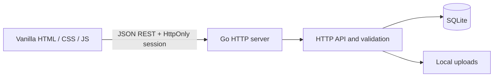

# GameTracker architecture

## Runtime

`cmd/server` reads environment configuration, opens SQLite, applies versioned SQL migrations, embeds the static web assets, and starts one Go HTTP server. `internal/httpapi` owns authentication middleware, JSON validation, ownership checks, and REST handlers. `internal/database` owns SQLite startup and migration application. `internal/formula` evaluates a limited arithmetic language. The browser code is plain ES modules in `web/js`.



## Ownership model

```text
User
└── Game
    ├── Sections ──< Section placements >── Objects
    ├── Object types ── Field definitions
    ├── Objects ── Field values
    ├── Objects ── Object relationships ── Objects
    └── Goals ── Goal tasks
```

Every game is owned by one user. A game owns its sections, object types, objects, and goals. The server checks the user through the parent game for every private operation. Composite foreign keys keep sections, object types, objects, placements, field values, and references within the same game or type.

## Games and sections

Games are the storage and authorization boundary. Sections are organizational views. A section stores its optional parent, display style, icon, order, and archive state. `section_placements` links a section to an object by stable IDs. The unique `(section_id, object_id)` key prevents duplicate placement in one section, while the same object may appear in many sections. Removing or archiving a section never deletes the object.

Nested section moves use a recursive query to reject cycles. A section stores its display style and a separate JSON display configuration. Card and table views may select visible fields. A checklist view selects one checkbox field from an object type, while a progress view selects one current/maximum progress field. The Go API verifies that selected fields are active fields owned by the same game and compatible with the selected view.

## Object types and fields

Object types belong to a game. Field definitions belong to an object type and have stable IDs. A database trigger and API validation prevent changing a field's type after creation. Renames and ordering changes retain the field ID.

Field definitions are not values. The `field_values` table stores JSON values by `(object_id, field_id)` and includes `object_type_id` in composite foreign keys to ensure compatible object/field types. Go validates every value against its field definition before writing. Empty values are `null` in a request and delete the stored value row. Defaults are kept on the field definition and used when an object has no stored value.

Reference fields are stored in `object_relationships`, not encoded as unverified object IDs inside JSON. The API validates both the target game and any optional allowed target type before inserting those relationships.

Formula fields store an expression in their JSON options. At read time, Go resolves stable field IDs and evaluates arithmetic using an explicit parser. Formula values are derived and are not saved as user-entered values. Missing numeric inputs and division by zero are returned as per-field formula errors. Formula dependencies are checked for cycles and block archiving of a field they use.

Archiving a field marks its definition inactive. The definition ID and all saved values remain in SQLite. Restoring the field exposes those same values again. Archiving is blocked when formulas or goals depend on the field.

## Goals and progress

Goals belong to a game rather than to a section. A goal may be manual, a checklist, numeric current/target progress, or a target linked to an object's numeric field. Checklist task state lives in `goal_tasks`. Field-target progress is read from the underlying object on every request, so changing the object value updates the goal immediately.

Progress fields store validated `{ "current": number, "max": number }` JSON values and display the ratio. There is no implicit average across fields.

## Authentication and sessions

Passwords are hashed with bcrypt. Session tokens are generated from cryptographic randomness; only a SHA-256 hash is stored in the `sessions` table. Cookies are HttpOnly and SameSite Lax, and become Secure when `APP_ENV=production`. A CSRF token is stored with each session and required in `X-CSRF-Token` for state-changing requests. Login attempts are limited by remote IP in memory.

## SQLite and migrations

The pure-Go SQLite driver avoids a separate C compiler. Foreign keys, WAL mode, and a busy timeout are enabled at connection startup. Database schema changes are ordered SQL files embedded in the binary and tracked in `schema_migrations`. The first migration creates the core tables, indexes, foreign keys, and immutable-field-type trigger.

The local database path is `data/gametracker.db`. Upload metadata is relational; image bytes are stored under `data/uploads` using generated filenames. Test databases are created under Go's temporary test directory.

## Frontend

`web/index.html`, `web/css/app.css`, and `web/js` are embedded into the Go binary. `app.js` starts the session check, `auth.js` renders sign-in and registration, `api.js` handles JSON and CSRF headers, and `workspace.js` renders games and dynamic game data. No build step is required.
