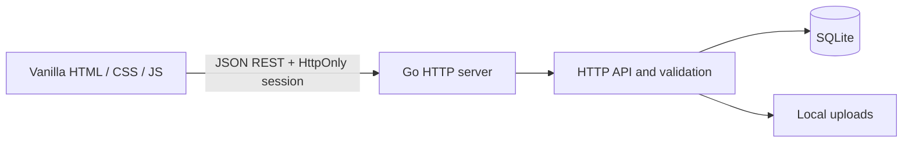

# GameTracker architecture

## Runtime

`cmd/server` reads environment configuration, opens SQLite, applies versioned SQL migrations, embeds the static web assets, and starts one Go HTTP server. `internal/httpapi` owns authentication middleware, JSON validation, ownership checks, and REST handlers. `internal/database` owns SQLite startup and migration application. `internal/formula` evaluates a limited arithmetic language. The browser code is plain ES modules in `web/js`.



## Ownership model

```text
User
└── Game
    ├── Sections ──< Section placements >── Objects
    ├── Object types ── Field definitions
    ├── Objects ── Field values
    ├── Objects ── Object relationships ── Objects
    ├── Objects ── Gallery images ── Uploaded assets
    ├── Objects ── Presets
    ├── Goals ── Goal tasks and dependencies
    └── Game dashboard layouts
```

Every game is owned by one user. A game owns its sections, object types, objects, and goals. The server checks the user through the parent game for every private operation. Composite foreign keys keep sections, object types, objects, placements, field values, and references within the same game or type.

Templates are user-owned reusable structure documents. Instantiation creates a new game and remaps section, type, field, and relationship identifiers in one transaction.

## Games and sections

Games are the storage and authorization boundary. Sections are organizational views. A section stores its optional parent, display style, icon, order, and archive state. `section_placements` links a section to an object by stable IDs. The unique `(section_id, object_id)` key prevents duplicate placement in one section, while the same object may appear in many sections. Removing or archiving a section never deletes the object.

Nested section moves use a recursive query to reject cycles. A section stores its display style and a separate JSON display configuration. Card, list, and table views share the same ordered visible-field selection. A checklist view selects one checkbox field from an object type, while a progress view can select one current/maximum field, sums of numeric fields from the same type, or a relationship and child progress field. Direct child progress remains the default for saved configurations. Recursive mode is an explicit opt-in and requires a relationship field restricted to the same object type. The Go API verifies that selected fields are active fields owned by the same game and compatible with the selected view.

## Object types and fields

Object types belong to a game and can be archived/restored without changing object or field archive flags. Active object views exclude archived types. Field definitions belong to an object type and have stable IDs. Renames and ordering changes retain the field ID. Type changes require the authenticated preview/apply endpoints; preview hashes the relevant field, object, relationship, goal, and section configuration state, while apply rechecks that revision inside a transaction.

Field definitions are not values. The `field_values` table stores JSON values by `(object_id, field_id)` and includes `object_type_id` in composite foreign keys to ensure compatible object/field types. Go validates every value against its field definition before writing. Empty values are `null` in a request and delete the stored value row. Defaults are kept on the field definition and used when an object has no stored value.

Reference fields are stored in `object_relationships`, not encoded as unverified object IDs inside JSON. The API validates both the target game and any optional allowed target type before inserting those relationships.

Formula fields store an expression in their JSON options. At read time, Go resolves stable field IDs and evaluates arithmetic using an explicit parser. Formula values are derived and are not saved as user-entered values. Missing numeric inputs, non-finite results, and division by zero are returned as per-field formula errors. Expressions are limited to 4096 bytes and dependency traversal to 128 fields. An optional relationship aggregation binds `@{related}` and accepts ordinary numeric or progress targets, avoiding recursive evaluation across objects. Formula dependencies are checked for cycles and block archiving of a field they use.

Archiving a field marks its definition inactive. The definition ID and all saved values remain in SQLite. Restoring the field exposes those same values again. Archiving is blocked when formulas, goals, or saved section views depend on the field. A field migration additionally reports primary display usage and blocks incompatible dependent configurations in its preview.

## Goals and progress

Goals belong to a game and can be linked into sections through `section_goal_placements`. A trigger verifies that each placed goal belongs to the section’s game. A goal may be manual, a checklist, numeric current/target progress, or an all/any rule over numeric, text, select, checkbox, or date fields. Rules are stored in `target_json` as a mode and condition array; legacy scalar numeric targets remain supported. Every condition validates the field against its specific object type and game. Checklist task state lives in `goal_tasks`. Field-target progress is read from the underlying object on every request, so changing the object value updates the goal immediately.

Object history stores one event per object mutation and normalized before/after rows for changed fields. It snapshots field names and types alongside stable IDs, so later renames do not rewrite historical meaning. Object updates, value updates, archive/restore, and history inserts share one transaction. History pages are bounded and can filter by event, field, and timestamp; the browser numeric chart reads at most 100 matching events.

`object_presets` stores named JSON overrides keyed to one object and game. Reads merge those overrides on top of canonical `field_values` and calculate formulas with the effective values; writes never replace canonical values or change goal evaluation. Preset references use the existing same-game relationship validation. Field-type migration previews include preset usage and refuse a type change until affected overrides are cleared.

`goal_dependencies` stores directed prerequisite edges between goals. The API validates same-game ownership, rejects self-edges and cycles transactionally, and blocks manual/numeric completion and completion of the final checklist task while any prerequisite is open. Deleting a goal cascades its dependency rows.

`game_dashboards` stores one bounded versioned JSON layout per game. It contains widget references and display configuration only; object values, goals, and sections remain canonical records. Every save validates configured sources. Dashboard images synchronize with `asset_references` in the same transaction. Widgets load independently through paginated object/goal endpoints. Archived sources remain in the saved layout and surface as unavailable in the widget.

`object_gallery` stores image IDs, captions, order, and one optional primary marker per object. It points to `uploaded_assets` without copying image bytes. Insert/delete triggers maintain `asset_references`, and validation triggers restrict images to the object's account and active upload state. Archived galleries remain readable; mutations require an active object and type. Removing a gallery row only removes its asset reference.

Object comparison uses `POST /api/games/{gameID}/comparison` to read only 2–4 active same-type object/configuration pairs. A subject may be a base object or a preset. Preset effective values and formulas are calculated server-side; the API returns shared active fields and labels for reference values. The client displays numeric extrema and differences, with higher/lower preference neutral unless the user changes it.

The relationship graph endpoint starts at one authenticated object and performs bounded breadth-first expansion over `object_relationships`. Each edge keeps its actual source, target, field ID, and field label; reverse discovery is marked without changing edge direction. Nodes are deduplicated by object ID, archived nodes remain visible but are not expanded, and each request is capped at depth 4, 100 nodes, and 200 edges. The SVG client expands selected nodes on demand, supports branch collapse, selection, center, zoom, and pan, and never requests a full-game graph automatically.

Progress fields store validated `{ "current": number, "max": number }` JSON values and display the ratio. Section display configuration can explicitly sum selected numeric fields for current and maximum, use a fixed maximum, or sum current/maximum from linked children. Recursive mode traverses the selected same-type relationship in batched breadth-first queries, then evaluates the graph in Go. Each root deduplicates leaf objects by stable ID. A node with children contributes no own progress; a leaf contributes its configured progress field. Archived objects/types and invalid or missing progress are excluded and produce partial/incomplete warnings. Cycles return an error with the named path and no percentage. Traversal is bounded to 64 levels and 10,000 objects. These derived displays do not modify saved field values.

## Authentication and sessions

Passwords are hashed with bcrypt. Session tokens are generated from cryptographic randomness; only a SHA-256 hash is stored in the `sessions` table. Cookies are HttpOnly and SameSite Lax, and become Secure when `APP_ENV=production`. A CSRF token is stored with each session and required in `X-CSRF-Token` for state-changing requests. Authentication attempts reserve rate-limit capacity atomically by remote IP before hashing, including registration and password changes. The limiter map and concurrent bcrypt work are bounded. JSON media types, Origin, and Fetch Metadata checks protect authentication and other writes. API data is not cached; CSP restricts executable code to same-origin files, while inline styles remain allowed for dynamic progress widths. Password updates and other-session revocation commit atomically.

## SQLite and migrations

The pure-Go SQLite driver avoids a separate C compiler. Foreign keys, WAL mode, and a busy timeout are enabled at connection startup. Database schema changes are ordered SQL files embedded in the binary and tracked in `schema_migrations`. The first migration creates the core tables, indexes, foreign keys, and immutable-field-type trigger. Migrations 005–011 add object history, audited field-type changes, templates, presets, goal dependencies, per-game dashboards, and object gallery records. Migration 006 replaces the immutable trigger with one that permits a type update only while a matching `applying` audit row exists in the same transaction.

Field migration converts stored values in bounded batches and includes archived objects. Integer conversions use exact decimal arithmetic and reject fractional values; numeric-to-text conversion uses canonical exact decimal formatting. Percentage conversion enforces the 0–100 range unless the user selects explicit clamping. Progress conversion requires an explicit current/maximum/percentage strategy or maximum. Formula-to-numeric conversion requires a freeze confirmation and stores a snapshot of each live formula result. Reference relationships can be preserved as serialized IDs in text or mapped from text/select values to active objects in the same game. Unsupported or ambiguous conversions remain blocked. Every applied conversion writes a migration audit row and per-object history event in the same transaction.

The local database path is `data/gametracker.db`. Upload metadata is relational; image bytes are stored under `data/uploads` using generated filenames. Test databases are created under Go's temporary test directory.

## Frontend

`web/index.html`, `web/css/app.css`, and `web/js` are embedded into the Go binary. `app.js` starts the session check, `auth.js` renders sign-in and registration, and `api.js` handles JSON and CSRF headers. `workspace.js` forwards to `workspace/index.js`, which composes private state, navigation, events, mutation handlers, focused views/components, and editor modules. Dependencies flow toward shared utilities and APIs; callbacks are injected without circular imports or state on `window`. No frontend build step is required.

The section tree uses existing parent/order columns and an atomic move handler. Active children of archived sections remain visible as tree roots without rewriting their parent IDs. Object query settings are stored under the existing section display configuration. Object API queries support parameterized name/type/description search, section/type scope, stable sorting, filters, and pagination. Base sorts and compatible typed field filters/sorts (numeric, text, select, boolean, date, and progress) run in SQLite before paging, including field defaults and globally accurate totals. Filter field IDs and operators are validated before the SQL is assembled; values remain bound parameters. Formula filters/sorts and reference filters retain the batched Go evaluator. The browser holds only the current object page plus a bounded detail cache. Reference, formula-preview, goal-condition, and placement selectors query server-side search results. Goal listing supports backend search, status/type filters, sorting, accurate totals, and pagination after live progress evaluation. Shared object/type reads are request-cached, checklist completion summaries are loaded in batches, and task/placement details are fetched in bounded batches for the returned page. Formula previews reuse Go schema validation, arithmetic parsing, and relationship aggregation without saving temporary inputs. Goal edits update task lists transactionally while retaining stable IDs and placements. Migration 004 adds an optional, type-validated primary display field reference; archived selections remain configured and render a safe fallback. The current follow-up adds no schema migration. See [improvements.md](improvements.md) for API details and verification.

Overview reads game-wide object statistics and the six most recently updated active objects from `GET /api/games/{gameID}/overview`. The query orders by `updated_at DESC, id ASC` and hydrates only those six objects; it does not reuse the current section or library page. Goal totals and the three recently updated goals continue to use the paginated game goals endpoint, whose summary totals are calculated across all game goals. The browser guards overview responses by game ID and request sequence, and reports loading, empty, and retryable error states separately.

## Images and resource bounds

New uploads are fully decoded within dimension/pixel limits, then encoded as static PNG to discard metadata and appended payloads. Two uploads may decode concurrently. Atomic quota enforcement allows 1000 files / 250 MB per account. Assets retain their account ownership when a game is deleted, preserving accounting and images reused across games. Referenced assets, including those used by archived records, cannot be deleted. Icon strings may contain short symbols or validated image URLs. Uploaded image references must belong to the current user.

Migration 002 adds game icons, type archiving, goal placements, and preservation of account-owned asset metadata when deleting games.

Migrations 005–011 add object history, field type migration audits, templates, presets, goal dependencies, per-game dashboard layouts, and object gallery records. Dashboard and gallery references use the existing asset lifecycle. Existing games, user data, and uploaded bytes are preserved by these additive schema changes.

## Review fixes and read performance

Object PATCH accepts optional `values` alongside name, description, and image. Validation, value updates, metadata updates, and the resulting value read occur in one transaction. Existing references to archived targets may be retained or removed; adding a new reference to an inactive target remains prohibited.

Object-list hydration batches values, relationships, and placements for a page and loads each type's definitions once. Goal evaluation caches type definitions and fully evaluated objects only within a read request, avoiding repeated reads when conditions or goals share objects. No cross-request cache is retained.

Field option updates run with value migrations in one transaction. `choice_replacements` maps removed choices to new choices for saved values, defaults, and goal targets, including archived objects. `remove_incompatible_references` explicitly authorizes removal of existing links when narrowing allowed types. Dependent aggregation/progress definitions must be updated first if a new allowed type would invalidate them.

Migration 003 adds `asset_references` keyed by stable asset ID and maintained by entity insert/update/delete triggers. It backfills existing local and legacy absolute upload references, including archived records. Source triggers reject new references to deleted or foreign-account uploads. Same-origin absolute upload URLs are canonicalized before persistence.

Image deletion commits `uploaded_assets.deleted_at` before filesystem cleanup. Pending assets cannot be served or referenced. After file removal succeeds (or the file is already absent), cleanup removes metadata. Failures remain durable and visible in settings. Startup, image listing/upload, and explicit deletion retries perform bounded cleanup attempts. Pending files count against the quota until cleanup completes. When a form uploads an image and its following save fails, the browser attempts idempotent deletion; the API rejects deletion if another active or archived record has attached the asset. Unreferenced uploads older than 24 hours are also queued for cleanup during existing cleanup runs, covering interrupted uploads whose response never reached the browser. This process uses existing asset metadata and requires no schema migration.
