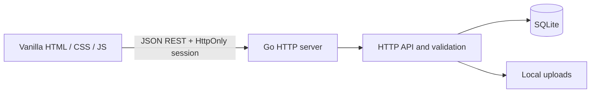

# GameTracker architecture

## Runtime

`cmd/server` reads environment configuration, opens SQLite, applies versioned SQL migrations, embeds the static web assets, and starts one Go HTTP server. `internal/httpapi` owns authentication middleware, JSON validation, ownership checks, and REST handlers. `internal/database` owns SQLite startup and migration application. `internal/formula` evaluates a limited arithmetic language. The browser code is plain ES modules in `web/js`.



## Ownership model

```text
User
└── Game
    ├── Sections ──< Section placements >── Objects
    ├── Object types ── Field definitions
    ├── Objects ── Field values
    ├── Objects ── Object relationships ── Objects
    └── Goals ── Goal tasks
```

Every game is owned by one user. A game owns its sections, object types, objects, and goals. The server checks the user through the parent game for every private operation. Composite foreign keys keep sections, object types, objects, placements, field values, and references within the same game or type.

## Games and sections

Games are the storage and authorization boundary. Sections are organizational views. A section stores its optional parent, display style, icon, order, and archive state. `section_placements` links a section to an object by stable IDs. The unique `(section_id, object_id)` key prevents duplicate placement in one section, while the same object may appear in many sections. Removing or archiving a section never deletes the object.

Nested section moves use a recursive query to reject cycles. A section stores its display style and a separate JSON display configuration. Card and table views may select visible fields. A checklist view selects one checkbox field from an object type, while a progress view can select one current/maximum field, sums of numeric fields from the same type, or a relationship and child progress field. The Go API verifies that selected fields are active fields owned by the same game and compatible with the selected view.

## Object types and fields

Object types belong to a game and can be archived/restored without changing object or field archive flags. Active object views exclude archived types. Field definitions belong to an object type and have stable IDs. A database trigger and API validation prevent changing a field's type after creation. Renames and ordering changes retain the field ID.

Field definitions are not values. The `field_values` table stores JSON values by `(object_id, field_id)` and includes `object_type_id` in composite foreign keys to ensure compatible object/field types. Go validates every value against its field definition before writing. Empty values are `null` in a request and delete the stored value row. Defaults are kept on the field definition and used when an object has no stored value.

Reference fields are stored in `object_relationships`, not encoded as unverified object IDs inside JSON. The API validates both the target game and any optional allowed target type before inserting those relationships.

Formula fields store an expression in their JSON options. At read time, Go resolves stable field IDs and evaluates arithmetic using an explicit parser. Formula values are derived and are not saved as user-entered values. Missing numeric inputs, non-finite results, and division by zero are returned as per-field formula errors. Expressions are limited to 4096 bytes and dependency traversal to 128 fields. An optional relationship aggregation binds `@{related}` and accepts ordinary numeric or progress targets, avoiding recursive evaluation across objects. Formula dependencies are checked for cycles and block archiving of a field they use.

Archiving a field marks its definition inactive. The definition ID and all saved values remain in SQLite. Restoring the field exposes those same values again. Archiving is blocked when formulas or goals depend on the field.

## Goals and progress

Goals belong to a game and can be linked into sections through `section_goal_placements`. A trigger verifies that each placed goal belongs to the section’s game. A goal may be manual, a checklist, numeric current/target progress, or an all/any rule over numeric, text, select, checkbox, or date fields. Rules are stored in `target_json` as a mode and condition array; legacy scalar numeric targets remain supported. Every condition validates the field against its specific object type and game. Checklist task state lives in `goal_tasks`. Field-target progress is read from the underlying object on every request, so changing the object value updates the goal immediately.

Progress fields store validated `{ "current": number, "max": number }` JSON values and display the ratio. Section display configuration can explicitly sum selected numeric fields for current and maximum, use a fixed maximum, or sum current/maximum from directly linked children. These derived displays do not modify saved field values.

## Authentication and sessions

Passwords are hashed with bcrypt. Session tokens are generated from cryptographic randomness; only a SHA-256 hash is stored in the `sessions` table. Cookies are HttpOnly and SameSite Lax, and become Secure when `APP_ENV=production`. A CSRF token is stored with each session and required in `X-CSRF-Token` for state-changing requests. Authentication attempts reserve rate-limit capacity atomically by remote IP before hashing, including registration and password changes. The limiter map and concurrent bcrypt work are bounded. JSON media types, Origin, and Fetch Metadata checks protect authentication and other writes. API data is not cached; CSP restricts executable code to same-origin files, while inline styles remain allowed for dynamic progress widths. Password updates and other-session revocation commit atomically.

## SQLite and migrations

The pure-Go SQLite driver avoids a separate C compiler. Foreign keys, WAL mode, and a busy timeout are enabled at connection startup. Database schema changes are ordered SQL files embedded in the binary and tracked in `schema_migrations`. The first migration creates the core tables, indexes, foreign keys, and immutable-field-type trigger.

The local database path is `data/gametracker.db`. Upload metadata is relational; image bytes are stored under `data/uploads` using generated filenames. Test databases are created under Go's temporary test directory.

## Frontend

`web/index.html`, `web/css/app.css`, and `web/js` are embedded into the Go binary. `app.js` starts the session check, `auth.js` renders sign-in and registration, and `api.js` handles JSON and CSRF headers. `workspace.js` forwards to `workspace/index.js`, which composes private state, navigation, events, mutation handlers, focused views/components, and editor modules. Dependencies flow toward shared utilities and APIs; callbacks are injected without circular imports or state on `window`. No frontend build step is required.

The section tree uses existing parent/order columns and an atomic move handler. Active children of archived sections remain visible as tree roots without rewriting their parent IDs. Object query settings are stored under the existing section display configuration. Local filtering uses stable field IDs and explicit object-type scope. Formula previews reuse Go schema validation, arithmetic parsing and relationship aggregation without saving temporary inputs. Goal edits update task lists transactionally while retaining stable IDs and placements. Migration 004 adds an optional, type-validated primary display field reference; archived selections remain configured and render a safe fallback. See [improvements.md](improvements.md) for API details and verification.

## Images and resource bounds

New uploads are fully decoded within dimension/pixel limits, then encoded as static PNG to discard metadata and appended payloads. Two uploads may decode concurrently. Atomic quota enforcement allows 1000 files / 250 MB per account. Assets retain their account ownership when a game is deleted, preserving accounting and images reused across games. Referenced assets, including those used by archived records, cannot be deleted. Icon strings may contain short symbols or validated image URLs. Uploaded image references must belong to the current user.

Migration 002 adds game icons, type archiving, goal placements, and preservation of account-owned asset metadata when deleting games.

## Review fixes and read performance

Object PATCH accepts optional `values` alongside name, description, and image. Validation, value updates, metadata updates, and the resulting value read occur in one transaction. Existing references to archived targets may be retained or removed; adding a new reference to an inactive target remains prohibited.

Object-list hydration batches values, relationships, and placements for a page and loads each type's definitions once. Goal evaluation caches type definitions and fully evaluated objects only within a read request, avoiding repeated reads when conditions or goals share objects. No cross-request cache is retained.

Field option updates run with value migrations in one transaction. `choice_replacements` maps removed choices to new choices for saved values, defaults, and goal targets, including archived objects. `remove_incompatible_references` explicitly authorizes removal of existing links when narrowing allowed types. Dependent aggregation/progress definitions must be updated first if a new allowed type would invalidate them.

Migration 003 adds `asset_references` keyed by stable asset ID and maintained by entity insert/update/delete triggers. It backfills existing local and legacy absolute upload references, including archived records. Source triggers reject new references to deleted or foreign-account uploads. Same-origin absolute upload URLs are canonicalized before persistence.

Image deletion commits `uploaded_assets.deleted_at` before filesystem cleanup. Pending assets cannot be served or referenced. After file removal succeeds (or the file is already absent), cleanup removes metadata. Failures remain durable and visible in settings. Startup, image listing/upload, and explicit deletion retries perform bounded cleanup attempts. Pending files count against the quota until cleanup completes.
